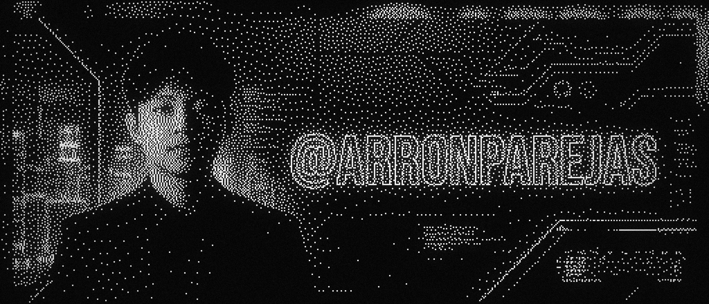

```text
┌── [ darknecrocities@terminal:~ ] ──────────────────────────────────┐
│                                                                    │
│   ___    ____  ____  ____  _   __   __ __ _______    _   __        │
│  /   |  / __ \/ __ \/ __ \/ | / /  / //_//  _/   |  / | / /        │
│ / /| | / /_/ / /_/ / / / /  |/ /  / ,<   / // /| | /  |/ /         │
│/ ___ |/ _, _/ _, _/ /_/ / /|  /  / /| |_/ // ___ |/ /|  /          │
│/_/  |_/_/ |_/_/ |_|\____/_/ |_/  /_/ |_/___/_/  |_/_/ |_/          │
│                                                                    │
│    ____  ___    ____  ______    _____   _____                      │
│   / __ \/   |  / __ \/ ____/   / /   | / ___/                      │
│  / /_/ / /| | / /_/ / __/ __  / / /| | \__ \                       │
│ / ____/ ___ |/ _, _/ /___/ /_/ / ___ |___/ /                       │
│/_/   /_/  |_/_/ |_/_____/\____/_/  |_/____/                        │
│                                                                    │
│ Arron Kian Parejas                                                 │
│ Software Engineer · AI/ML Engineer · FullStack Engineer            │
│ Location: Philippines (UTC+8)                                      │
└────────────────────────────────────────────────────────────────────┘
```

<div align="center">



<br/><br/>

<a href="https://git.io/typing-svg">
  
</a>

<br/>

<p align="center">
  <a href="https://arronparejas.dev"></a>
  <a href="mailto:parejasarronkian@gmail.com"></a>
  <a href="https://www.linkedin.com/in/arron-parejas-6711b6289"></a>
  <a href="https://orcid.org/0009-0004-9524-7387"></a>
  <a href="https://github.com/darknecrocities"></a>
  
</p>

</div>

---

## ❯ 01 // ABOUT ME

```bash
$ cat /etc/profile.d/about.txt
```

I am a **Software Engineer**, **AI/ML Engineer**, and **FullStack Engineer** dedicated to building high-impact systems across analytics, automation, and full-stack development. I specialize in transforming data into intelligence, crafting scalable architectures, and engineering solutions that push boundaries.

- `Software Engineering` — building secure, scalable, production-grade applications
- `AI/ML Engineering` — deploying intelligent models and automation systems
- `AI/ML Researcher` — experienced researcher across various models and techniques to enhance performance
- `Full-Stack Development` — creating complete, performance-driven web apps
- Always open to **collaboration** and large-scale engineering projects

---

## ❯ 02 // PERFORMANCE & RANKINGS

<div align="center">

[](https://user-badge.committers.top/philippines_public/darknecrocities)

<br/><br/>

| Joined | Placement | Finalist | Champion |
|:------:|:---------:|:--------:|:--------:|
| 35x | 17x | 10x | 7x |

<br/>

> _Consistently placing in competitive national and world level tech events._

</div>

---

## ❯ 03 // METRICS & ACTIVITY

<div align="center">

<p align="center">
  
  
  
</p>


<br/>

<a href="https://git.io/streak-stats">
  
</a>

</div>

---

## ❯ 04 // TECH STACK

### ❯ /usr/bin/languages
<p align="center">
  
  
  
  
  
  
  
  
  
  
  
  
</p>

### ❯ /opt/mobile
<p align="center">
  
  
  
  
  
  
  
  
  
  
</p>

### ❯ /srv/frontend
<p align="center">
  
  
  
  
  
  
  
  
  
  
</p>

### ❯ /var/backend
<p align="center">
  
  
  
  
  
  
  
  
</p>

### ❯ /var/data/databases
<p align="center">
  
  
  
  
  
</p>

### ❯ /etc/cloud-devops
<p align="center">
  
  
  
  
  
  
  
  
</p>

### ❯ /opt/ai-data-science
<p align="center">
  
  
  
  
  
  
  
</p>

### ❯ /usr/local/ai-tools
<p align="center">
  
  
  
  
  
  
  
  
  
  
</p>

---

## ❯ 05 // SYSTEM QUOTE

<div align="center">

[](https://github.com/piyushsuthar/github-readme-quotes)

</div>

<br/>

```text
─────────────────────────────────────────────────────────────────
[EOF] · darknecrocities/darknecrocities · end of transmission
─────────────────────────────────────────────────────────────────
```
